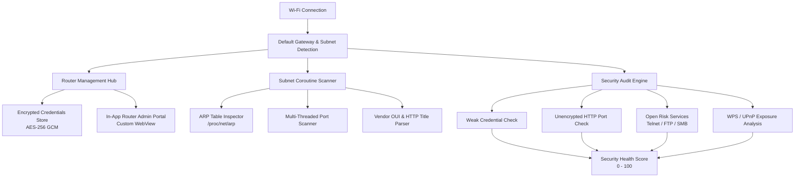

<div align="center">

# 🌐 RouterHub Android

### *The Modern, On-Device Network Companion & Security Auditor for Android*

[](https://github.com/sakhanamit/RouterHubAndroid)
[](https://github.com/sakhanamit/RouterHubAndroid/releases)
[](https://www.android.com/)
[](https://kotlinlang.org/)
[](https://developer.android.com/jetpack/compose)
[](LICENSE)

<br />

[  📥 **Download APK (v1.0.0)**  ](https://github.com/sakhanamit/RouterHubAndroid/raw/master/RouterHub.apk) &nbsp; | &nbsp; [  📜 **Release Notes**  ](RELEASE_NOTES.md) &nbsp; | &nbsp; [  🐛 **Report Issue**  ](https://github.com/sakhanamit/RouterHubAndroid/issues)

</div>

---

## 💡 Overview

**RouterHub** is an all-in-one Android network management, device discovery, and Wi-Fi security auditing suite. Built 100% with modern Android standards (**Jetpack Compose**, **Material 3**, and **Kotlin Coroutines**), RouterHub turns your phone into a powerful pocket network administrator.

Without relying on any cloud services or remote tracking, RouterHub discovers your active Wi-Fi gateway, maps every connected device on your `/24` subnet, detects open ports and hardware vendor details, and audits your router against critical security vulnerabilities.

---

## 🗺️ System Architecture



---

## 🔥 Key Capabilities

| Feature | Description | Tech Highlight |
| :--- | :--- | :--- |
| 📡 **Smart Router Discovery** | Detects Wi-Fi default gateway IP and subnet dynamically | Android `ConnectivityManager` |
| 🔑 **Encrypted Vault** | Store router login credentials safely on-device | `EncryptedSharedPreferences` (AES-256 GCM) |
| 🔍 **Subnet Device Scanner** | Scans all 254 local IP addresses concurrently | High-concurrency Kotlin Coroutines |
| 🏷️ **Hardware Identification** | Resolves MAC addresses, Vendor OUI, Brand, and Model | Kernel ARP inspection (`/proc/net/arp`) |
| 🛡️ **Security Audit Engine** | Computes a 0–100 Security Score with severity ratings | Multi-point vulnerability heuristic scanner |
| 🎨 **Material 3 UI** | Modern, dark-mode native Jetpack Compose interface | 100% Declarative UI with Material You |

---

## 🚀 Key Modules & Screenshots

### 🎛️ 1. Multi-Router Administration
* **Gateway Auto-Discovery:** Instant identification of gateway IP upon connecting to Wi-Fi.
* **Profile Management:** Store profiles for home, office, and secondary access points.
* **Embedded Admin Portal:** Integrated WebView with custom user-agent toggles, HTTP Basic Auth support, and SSL exception bypass for local router dashboards.
* **On-Device Encryption:** All credentials protected via Android Keystore.

### 🔍 2. High-Speed Subnet & Port Scanner
* **Concurrent Subnet Sweep:** Asynchronously checks `/24` subnets (up to 254 host IPs).
* **Device Categorization:** Auto-classifies host devices as *Routers, Smartphones, Computers, Smart TVs, IoT, Printers, Cameras, or Network Storage*.
* **Diagnostic Metrics:** Ping latency response times (`pingMs`), open ports (HTTP, HTTPS, SSH, FTP, Telnet, SMB), and web page banner titles.
* **Instant Clipboard Copy:** One-tap copying for IP and MAC addresses.

### 🛡️ 3. Automated Wi-Fi Security Audit
* **Security Scorecard:** Generates a real-time 0–100 security rating.
* **Risk Categorization:** Evaluates issues across `CRITICAL`, `HIGH`, `MEDIUM`, `LOW`, and `INFO` levels.
* **Audited Vulnerabilities:**
  * Unencrypted HTTP web interfaces exposing session credentials.
  * Open high-risk legacy ports (Telnet, FTP, SMB file sharing).
  * Default factory credential vulnerability risks.
  * UPnP and WPS exposure warnings.
* **Actionable Remediation:** Step-by-step guidance on hardening your router configuration.

---

## 📥 Installation

### Option A: Direct APK Download
You can download and install the latest compiled APK directly from the repository:

| File | Type | Description | Link |
| :--- | :--- | :--- | :--- |
| `RouterHub.apk` | Release Build | Optimised production APK | [**Download APK**](https://github.com/sakhanamit/RouterHubAndroid/raw/master/RouterHub.apk) |
| `RouterHub-debug.apk` | Debug Build | Standalone debug build with logging | [**Download Debug APK**](https://github.com/sakhanamit/RouterHubAndroid/raw/master/RouterHub-debug.apk) |

> **Note:** Ensure *"Install from Unknown Sources"* is enabled in your Android device settings.

---

### Option B: Build from Source

#### Prerequisites
* **Android Studio:** Ladybug (2024.2.1+) or standard modern release
* **JDK:** Java 17+
* **Android SDK:** API 34+ (Target SDK 34 / Min SDK 26)

#### Steps
```bash
# 1. Clone the repository
git clone https://github.com/sakhanamit/RouterHubAndroid.git

# 2. Navigate to the project directory
cd RouterHubAndroid

# 3. Build debug APK using Gradle
./gradlew assembleDebug
```

The output APK will be located at `app/build/outputs/apk/debug/app-debug.apk`.

---

## 🔒 Security & Privacy First

RouterHub is built on a **Strict Zero-Telemetry Privacy Policy**:
* 🚫 **No External Analytics:** Zero tracking scripts, telemetry, or analytics SDKs.
* 🔒 **100% On-Device Processing:** All subnet scans, ARP resolution, and security checks execute locally on your hardware.
* 🔑 **Hardware-Backed Encryption:** Credentials are stored securely using Android Keystore and `EncryptedSharedPreferences`.

### Declared Android Permissions
| Permission | Purpose |
| :--- | :--- |
| `INTERNET` | Execute local socket connections and subnet ping checks |
| `ACCESS_NETWORK_STATE` | Read Wi-Fi connection parameters, gateway IP, and subnet masks |
| `ACCESS_WIFI_STATE` | Verify active Wi-Fi status before initiating scans |

---

## 🛠️ Tech Stack & Architecture

* **Language:** [Kotlin](https://kotlinlang.org/)
* **UI Framework:** [Jetpack Compose](https://developer.android.com/jetpack/compose) + [Material 3](https://m3.material.io/)
* **Asynchronous Processing:** Kotlin Coroutines (`Dispatchers.IO`) & `StateFlow`
* **Security & Storage:** `androidx.security:security-crypto`
* **Network Inspection:** Java Socket NIO, ARP table inspection (`/proc/net/arp`), HTTP banner grabbing

---

## 📄 License

This project is licensed under the [MIT License](LICENSE).

---

<div align="center">
  <sub>Built with ❤️ for privacy-conscious Android network administrators.</sub>
</div>
