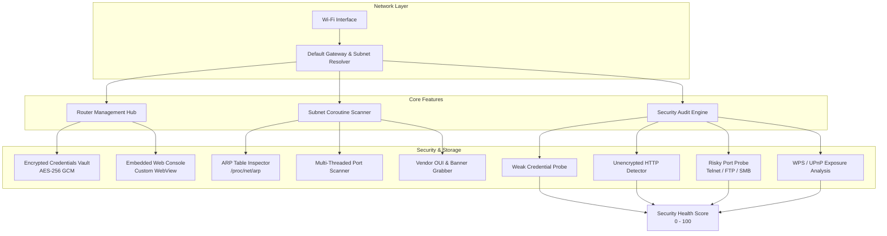

<div align="center">

# 🌐 RouterHub Android

### *The Ultimate Modern Network Administrator & Security Companion for Android*

[](https://sakhanamit.github.io/RouterHubAndroid/)
[](https://github.com/sakhanamit/RouterHubAndroid)
[](https://github.com/sakhanamit/RouterHubAndroid/releases)
[](https://www.android.com/)
[](https://kotlinlang.org/)
[](https://developer.android.com/jetpack/compose)
[](LICENSE)

<br/>

[ 🌐 **Visit Live Webpage** ](https://sakhanamit.github.io/RouterHubAndroid/) &nbsp;•&nbsp; [ 📥 **Download Release APK (v1.0.0)** ](https://github.com/sakhanamit/RouterHubAndroid/raw/master/RouterHub.apk) &nbsp;•&nbsp; [ 📜 **Release Notes** ](RELEASE_NOTES.md)

</div>

---

## ⚡ Introduction

**RouterHub** is a high-performance, privacy-focused Android application designed to put professional network administration, router management, device discovery, and security auditing into your pocket.

Built from the ground up with **Kotlin Coroutines**, **Jetpack Compose**, **Material 3**, and **Hardware Encryption**, RouterHub eliminates the friction of discovering local IP addresses, accessing router dashboards, identifying connected Wi-Fi hosts, and auditing home networks for security vulnerabilities.

---

## 🏗️ System Architecture



---

## 🔥 Key Feature Comparison

| Capability | RouterHub Android | Standard Wi-Fi Apps |
| :--- | :---: | :---: |
| 📡 **Smart Gateway Discovery** | ✅ Instant Auto-Detect | ❌ Manual IP Entry |
| 🔐 **Encrypted Credentials Store** | ✅ Hardware AES-256 GCM | ❌ Plaintext / None |
| ⚡ **Subnet Coroutine Sweep** | ✅ Concurrent 254 Hosts (<3s) | ⚠️ Slow / Sequential |
| 🏷️ **Kernel ARP Hardware ID** | ✅ Resolution via `/proc/net/arp` | ❌ Generic IP Only |
| 🛡️ **Automated Security Audit** | ✅ 0–100 Rating + Fix Guide | ❌ Basic Ping Only |
| 🔒 **100% On-Device & No Telemetry** | ✅ Zero Analytics / Tracking | ❌ Cloud Telemetry |

---

## 🚀 Module Deep-Dive

<details font-size="16px">
<summary><b>📡 1. Multi-Router Administration & Management</b> (Click to Expand)</summary>

<br/>

* **Dynamic Gateway Resolver:** Automatically identifies active gateway router IPs (`ConnectivityManager` & route tables).
* **Router Profiles:** Store and manage configurations for multiple routers (home, office, secondary APs).
* **Embedded Configuration Portal:** Custom-tuned WebView with desktop user-agent switching, HTTP basic auth support, and self-signed SSL bypass for local router dashboards.
* **Hardware Credential Security:** Router login passwords encrypted via `EncryptedSharedPreferences` (AES-256 GCM + Android Keystore).
</details>

<details font-size="16px">
<summary><b>🔍 2. High-Speed Subnet & Port Scanner</b> (Click to Expand)</summary>

<br/>

* **Concurrent Subnet Sweep:** Asynchronously probes all 254 hosts on a `/24` subnet using Kotlin Coroutine dispatchers.
* **Device Classification:** Auto-classifies hosts as *Routers, Smartphones, Computers, Smart TVs, IoT, Printers, Cameras, or Network Storage*.
* **Comprehensive Host Diagnostics:**
  * IP & MAC address resolution via ARP inspection (`/proc/net/arp`).
  * Vendor OUI, Brand, and Model mapping.
  * Ping response latency (`pingMs`).
  * Open port identification (HTTP, HTTPS, SSH, FTP, Telnet, RTSP, SMB) & web title extraction.
* **One-Tap Clipboard Copy:** Fast copying for IP and MAC addresses.
</details>

<details font-size="16px">
<summary><b>🛡️ 3. Automated Wi-Fi Security Audit Engine</b> (Click to Expand)</summary>

<br/>

* **0–100 Security Rating:** Real-time health score with color-coded severity levels (`CRITICAL`, `HIGH`, `MEDIUM`, `LOW`, `INFO`).
* **Multi-Point Vulnerability Checks:**
  * Unencrypted HTTP router management portals.
  * Exposed high-risk legacy ports (Telnet 23, FTP 21, SMB 445).
  * Weak/default administrative credential exposure risks.
  * UPnP and WPS security exposure.
* **Step-by-Step Remediation:** Clear hardening recommendations for every flagged issue.
</details>

---

## 📦 Direct Downloads

| Artifact | Build Type | Description | Link |
| :--- | :--- | :--- | :--- |
| `RouterHub.apk` | **Release** | Production release APK | [**📥 Download Release APK**](https://github.com/sakhanamit/RouterHubAndroid/raw/master/RouterHub.apk) |
| `RouterHub-debug.apk` | **Debug** | Standalone debug build | [**📥 Download Debug APK**](https://github.com/sakhanamit/RouterHubAndroid/raw/master/RouterHub-debug.apk) |

---

## 🛠️ Build from Source

### Prerequisites
* **Android Studio:** Ladybug (2024.2.1+) or newer
* **JDK:** Java 17+
* **Android SDK:** Target SDK 34 (Android 14) / Min SDK 26 (Android 8.0)

### Quick Build Commands
```bash
# Clone repository
git clone https://github.com/sakhanamit/RouterHubAndroid.git
cd RouterHubAndroid

# Assemble debug build
./gradlew assembleDebug
```

---

## 🔒 Privacy & Permissions

RouterHub strictly enforces a **Zero-Telemetry, 100% On-Device Data Policy**:
* 🚫 **No Tracking:** Zero analytics SDKs or remote logging.
* 🔒 **Local Execution:** All port scans, ARP queries, and security checks execute exclusively on your local hardware.

| Permission | Reason |
| :--- | :--- |
| `INTERNET` | Perform local socket probes and subnet ping checks |
| `ACCESS_NETWORK_STATE` | Read active Wi-Fi IP, gateway, and subnet mask |
| `ACCESS_WIFI_STATE` | Verify active Wi-Fi connection state |

---

## 📄 License & Attribution

Distributed under the **MIT License**. See [`LICENSE`](LICENSE) for details.

<div align="center">
  <sub>Designed & Developed for Privacy-Conscious Android Network Engineers.</sub>
</div>
