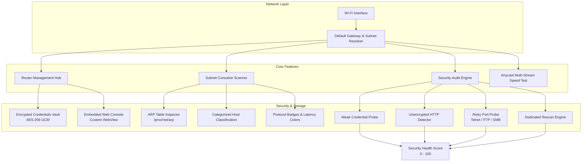

<div align="center">

# 🌐 RouterHub Android

### *The Ultimate Modern Network Administrator & Security Companion for Android*

[](https://sakhanamit.github.io/RouterHubAndroid/)
[](https://github.com/sakhanamit/RouterHubAndroid/raw/master/RouterHub-v1.2-release.apk)
[](https://github.com/sakhanamit/RouterHubAndroid)
[](https://github.com/sakhanamit/RouterHubAndroid/releases)
[](https://www.android.com/)
[](https://kotlinlang.org/)
[](LICENSE)

<br/>

### 🚀 **Quick Download Links (v1.2.0)**

| Package | Direct Download Link | Description | Size |
| :--- | :--- | :--- | :---: |
| 🟢 **Release APK** | [**📥 Download RouterHub-v1.2-release.apk**](https://github.com/sakhanamit/RouterHubAndroid/raw/master/RouterHub-v1.2-release.apk) | Production Release Build | ~11.4 MB |
| 🔵 **Debug APK** | [**📥 Download RouterHub-v1.2-debug.apk**](https://github.com/sakhanamit/RouterHubAndroid/raw/master/RouterHub-v1.2-debug.apk) | Standalone Debug Build | ~16.4 MB |
| 🌐 **Live Webpage** | [**Visit Webpage**](https://sakhanamit.github.io/RouterHubAndroid/) | Interactive Demo & Documentation | -- |
| 📜 **Release Notes** | [**View Release Notes**](RELEASE_NOTES.md) | Version 1.2.0 Changelog | -- |

</div>

---

## ⚡ Introduction

**RouterHub** is a high-performance, privacy-focused Android application designed to put professional network administration, router management, device discovery, speed testing, and security auditing into your pocket.

Built from the ground up with **Kotlin Coroutines**, **Jetpack Compose**, **Material 3**, and **Hardware Encryption**, RouterHub eliminates the friction of discovering local IP addresses, accessing router dashboards, identifying connected Wi-Fi hosts, and auditing home networks for security vulnerabilities.

---

## 🆕 What's New in v1.2.0

* ⚡ **Accurate Multi-Stream Speed Test:** Resolved premature ~5s termination. Implemented full-duration TCP saturation (10s multi-stream download, 8s upload, 1.5–2s latency/jitter test) using Cloudflare Anycast edge servers with FCC/Ookla warm-up filtering.
* 📈 **Live Throughput Wave (Sparkline):** Real-time stream chart showing live speed fluctuations with gradient fill.
* 🎯 **Dynamic Adaptive Speedometer:** Gauge scale automatically scales (100, 250, 500, or 1000 Mbps) with radial graduation ticks, glowing pointer, and tabular digital readouts.
* 🎬 **Network Capability Assessment:** Automatic verdict for 4K/8K Video Streaming, Low-Latency Gaming, HD Video Conferencing, and Cloud Backups.
* ✨ **Silky Smooth Navigation:** Added Compose `Crossfade` transitions across tabs and streamlined top app bar with overflow menu.

---

## 📥 Direct Download & Installation Guide

### Option 1: Direct APK Download
1. Click [**Download RouterHub-v1.2-release.apk**](https://github.com/sakhanamit/RouterHubAndroid/raw/master/RouterHub-v1.2-release.apk) to get the latest APK.
2. Transfer or open the file on your Android device (Android 8.0+ / API 26+).
3. Enable **"Install from Unknown Sources"** if prompted by Android.
4. Tap install and launch **RouterHub**!

---

## 🏗️ System Architecture



---

## 🔥 Key Feature Comparison

| Capability | RouterHub Android | Standard Wi-Fi Apps |
| :--- | :---: | :---: |
| 📡 **Smart Gateway Discovery** | ✅ Instant Auto-Detect & Dynamic Polling | ❌ Manual IP Entry |
| 🔐 **Encrypted Credentials Store** | ✅ Hardware AES-256 GCM | ❌ Plaintext / None |
| ⚡ **Subnet Coroutine Sweep** | ✅ Categorized Devices + Protocol Badges | ⚠️ Slow / Uncategorized |
| 🚀 **High-Speed Anycast Speed Test** | ✅ Multi-Stream 10s Saturation + Live Wave | ❌ None / Basic Ping |
| 🛡️ **Automated Security Audit** | ✅ 0–100 Rating + Dedicated Rescan | ❌ Basic Ping Only |
| 🔒 **100% On-Device & Privacy Masking** | ✅ Zero Analytics + IP/MAC Masking | ❌ Cloud Telemetry |

---

## 🚀 Module Deep-Dive

<details font-size="16px">
<summary><b>📡 1. Multi-Router Administration & Management</b> (Click to Expand)</summary>

<br/>

* **Dynamic Gateway Resolver:** Automatically identifies active gateway router IPs (`ConnectivityManager` & route tables) with dynamic 3s polling.
* **Router Profiles:** Store and manage configurations for multiple routers (home, office, secondary APs).
* **Embedded Configuration Portal:** Custom-tuned WebView with desktop user-agent switching, HTTP basic auth support, and self-signed SSL bypass for local router dashboards.
* **Hardware Credential Security:** Router login passwords encrypted via `EncryptedSharedPreferences` (AES-256 GCM + Android Keystore).
</details>

<details font-size="16px">
<summary><b>🔍 2. High-Speed Subnet & Port Scanner</b> (Click to Expand)</summary>

<br/>

* **Concurrent Subnet Sweep:** Asynchronously probes all 254 hosts on a `/24` subnet using Kotlin Coroutine dispatchers.
* **Categorized Device Identification:** Auto-classifies hosts as *Gateways & Routers, Smartphones & Mobile, Computers & Laptops, Smart TVs & Media, Smart Home & IoT, Printers & Cameras, or Network Storage*.
* **Comprehensive Host Diagnostics:**
  * IP & MAC address resolution via ARP inspection (`/proc/net/arp`).
  * Protocol badges (`HTTP`, `HTTPS`, `SSH`, `TELNET`, `SMB`, `RTSP`, `WEB`).
  * Color-coded ping latency (`⚡ 12ms` green, `📶 48ms` amber, `🐢 165ms` red).
* **Privacy Data Masking:** One-tap top bar toggle to mask IP (`192.168.1.***`) and MAC (`50:C7:BF:**:**:**`) for privacy and screenshots.
</details>

<details font-size="16px">
<summary><b>🚀 3. Anycast Multi-Stream Speedometer Test</b> (Click to Expand)</summary>

<br/>

* **Cloudflare Anycast CDN:** High-bandwidth speed test engine powered by Cloudflare Anycast global edge servers (`speed.cloudflare.com`).
* **Continuous Multi-Stream Saturation:** Parallel coroutine download workers continuously streaming chunks for true TCP saturation over a full 10-second download and 8-second upload window.
* **Dynamic Adaptive Speedometer:** Radial graduation ticks with automatic scale switching (100, 250, 500, 1000 Mbps).
* **Live Throughput Wave & Capabilities:** Real-time sparkline speed curve and automated streaming/gaming/video call quality verdicts.
* **Zero-Allocation Memory Engine:** Static buffer reuse (`REUSABLE_BUFFER`), eliminating Garbage Collection overhead and OutOfMemory crashes.
</details>

<details font-size="16px">
<summary><b>🛡️ 4. Automated Wi-Fi Security Audit Engine</b> (Click to Expand)</summary>

<br/>

* **0–100 Security Rating:** Real-time health score with color-coded severity levels (`CRITICAL`, `HIGH`, `MEDIUM`, `LOW`, `INFO`).
* **Dedicated Rescan Button:** On-demand security re-auditing button with real-time status animation.
* **Multi-Point Vulnerability Checks:**
  * Unencrypted HTTP router management portals.
  * Exposed high-risk legacy ports (Telnet 23, FTP 21, SMB 445).
  * Weak/default administrative credential exposure risks.
</details>

---

## 🛠️ Build from Source

### Prerequisites
* **Android Studio:** Ladybug (2024.2.1+) or newer
* **JDK:** Java 17+
* **Android SDK:** Target SDK 34 (Android 14) / Min SDK 26 (Android 8.0)

### Quick Build Commands
```bash
# Clone repository
git clone https://github.com/sakhanamit/RouterHubAndroid.git
cd RouterHubAndroid

# Assemble debug and release builds
./gradlew assembleDebug assembleRelease
```

---

## 🔒 Privacy & Permissions

RouterHub strictly enforces a **Zero-Telemetry, 100% On-Device Data Policy**:
* 🚫 **No Tracking:** Zero analytics SDKs or remote logging.
* 🔒 **Local Execution:** All port scans, ARP queries, and security checks execute exclusively on your local hardware.

| Permission | Reason |
| :--- | :--- |
| `INTERNET` | Perform local socket probes, speed test, and subnet ping checks |
| `ACCESS_NETWORK_STATE` | Read active Wi-Fi IP, gateway, and subnet mask |
| `ACCESS_WIFI_STATE` | Verify active Wi-Fi connection state |

---

## 📄 License & Attribution

Distributed under the **MIT License**. See [`LICENSE`](LICENSE) for details.

<div align="center">
  <sub>Designed & Developed for Privacy-Conscious Android Network Engineers.</sub>
</div>
